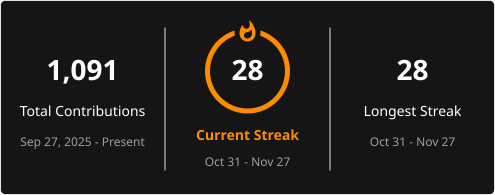

  

<h1 align="center">Iqbol Toshmatov</h1>

  <b>C# / .NET engineer.</b> I build backend platforms and the agent workflows around them. 
  APIs, PostgreSQL and Docker first. Then agent connections, tool use and GitHub integration.

  
  

## What I do

| .NET backend | AI engineering | Delivery |
| --- | --- | --- |
| ASP.NET Core, DDD, CQRS, PostgreSQL, PostGIS, Redis, RabbitMQ | Agent workflows, agent API and CLI, GitHub App, tool use | Docker, CI, tests, ADRs |

## How I build

- **Domain first.** Model the business before choosing a framework or a model.
- **AI at the edge.** Keep prompts, tools and providers behind a small interface.
- **Proof over claims.** Tests at public seams and ADRs for hard decisions.

## Featured work

### [ai_dev_platform](https://github.com/ToshmatovDeveloper/ai_dev_platform)

AI-first development platform. Specs, ADRs and an agent workflow for building software with AI. Agent connections, a GitHub App and access control.

`.NET 10` · `ASP.NET Core` · `PostgreSQL` · `React` · `agents`

### [GeoDelivery](https://github.com/ToshmatovDeveloper/GeoDelivery)

Food-delivery backend built as a modular monolith on .NET 10: DDD, CQRS, PostgreSQL/PostGIS and Redis.

`.NET 10` · `ASP.NET Core` · `PostgreSQL` · `Redis` · `Docker`

### [matt-pocock-skills-ru](https://github.com/ToshmatovDeveloper/matt-pocock-skills-ru)

Russian descriptions of Matt Pocock's agent skills: what each skill does and when to use it.

`AI agents` · `documentation` · `Russian`

## Stack

**Backend:** C#, .NET, ASP.NET Core, EF Core, PostgreSQL, PostGIS, Redis, RabbitMQ, Elasticsearch, Docker.  
**AI:** Agent workflows, agent API and CLI, GitHub App, tool use, prompt and skill design.  
**Practices:** DDD, CQRS, modular monolith, ADRs, tests at public seams.

## Currently

- Building `ai_dev_platform`: an AI-first development platform with agent connections and a GitHub App.
- Writing Russian descriptions of agent skills.

## Activity

  
  

