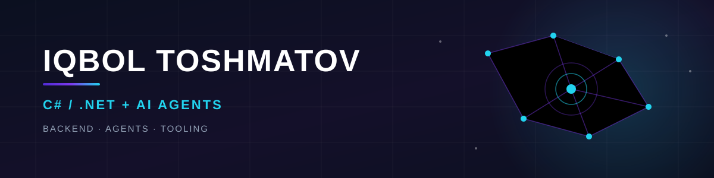

  

<h1 align="center">Iqbol Toshmatov</h1>

  <b>C# / .NET engineer.</b> I build backend platforms and the agent workflows around them. 
  APIs, PostgreSQL and Docker first. Then agent connections, tool use and GitHub integration.

  
  

  Selected work is pinned below.

## Activity

  
  

## Contribution snake

  <picture>
    <source media="(prefers-color-scheme: dark)" srcset="https://raw.githubusercontent.com/ToshmatovDeveloper/ToshmatovDeveloper/output/github-contribution-grid-snake-dark.svg" />
    <source media="(prefers-color-scheme: light)" srcset="https://raw.githubusercontent.com/ToshmatovDeveloper/ToshmatovDeveloper/output/github-contribution-grid-snake.svg" />
    
  </picture>

## Top languages

  

